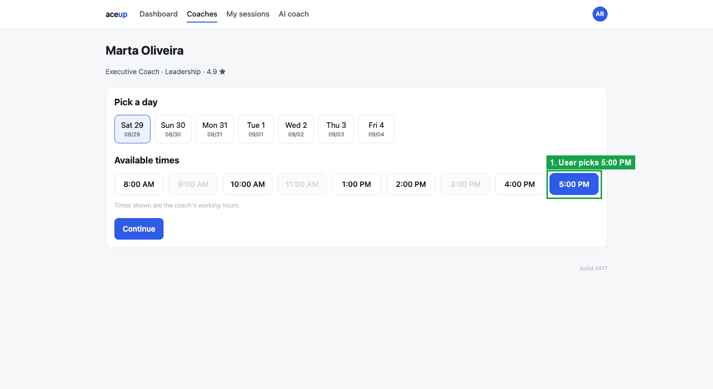
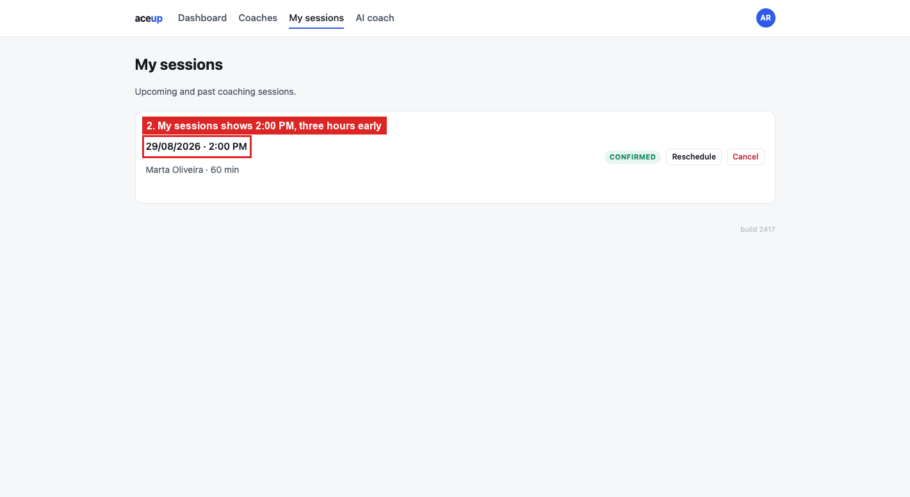

# BUG-01: the time you book is not the time you see

> **Seed:** `2417` · Chrome 141, macOS 15 (Darwin 25.6.0) · viewport 1400x900 unless the
> finding says otherwise · app served over HTTP at `http://localhost:4173` · 28 Aug 2026
>
> Clear state before reproducing:
> ```js
> Object.keys(localStorage).filter(k => k.startsWith('aceup.')).forEach(k => localStorage.removeItem(k));
> ```
> Check the footer says **build 2417** before you start.

| | |
|---|---|
| **Severity** | Critical |
| **Priority** | P0 |
| **Where I think it lives** | Date formatting in the session renderer (dashboard and My sessions) |

**Why P0.** The stored record is right, so this is a display fix rather than a data
migration. But until it ships, members are showing up at the wrong hour, or missing sessions
entirely. There is no workaround, and nothing on screen hints the time might be wrong.

**Preconditions:** clean state, seed 2417.

**Steps**
1. Open `http://localhost:4173/booking.html?coach=c1&seed=2417` (Marta Oliveira).
2. Leave the pre-selected day, **Sat 29 (08/29)**.
3. Click the **5:00 PM** slot.
4. Click **Continue**. The modal correctly says `Time 5:00 PM`.
5. Click **Confirm booking**.
6. Go to **My sessions**.

**Expected**
The session shows as `29/08/2026 · 5:00 PM`. That is what I picked, and what the modal showed
one step earlier.

**Actual**
It shows as `29/08/2026 · 2:00 PM`. Three hours early. The dashboard "Next session" card
shows the same wrong time.

The stored record is correct:

```json
{"coachName":"Marta Oliveira","tzOffset":-3,"tzLabel":"America/Sao_Paulo",
 "date":"2026-08-29","hour":17,"startsAt":"2026-08-29T17:00:00Z","status":"confirmed"}
```

Nothing in the console.

**The shift is the coach's timezone offset.** I checked four coaches. The displayed time is
the booked time *plus* `tzOffset`, so coaches east of UTC push the session later in the day
and coaches west push it earlier:

| Coach | Timezone | Offset | Booked | Shown | Off by |
|---|---|---|---|---|---|
| Yuki Tanaka | Asia/Tokyo | +9 | 10:00 AM | 7:00 PM | +9 h |
| Priya Raman | Asia/Kolkata | +5 | 8:00 AM | 1:00 PM | +5 h |
| Marta Oliveira | America/Sao_Paulo | −3 | 5:00 PM | 2:00 PM | −3 h |
| Daniel Whitfield | America/New_York | −5 | 11:00 AM | 6:00 AM | −5 h |
| Daniel Whitfield | America/New_York | −5 | 3:00 PM (rescheduled) | 10:00 AM | −5 h |

The Tokyo case is the ugliest: a 10 AM session shows up as 7 PM, moving it from morning to
evening. Reschedule does the same thing, so this is not limited to the booking path.

`startsAt` is written with a `Z` suffix even though the hour is local wall-clock time. Any
renderer that parses that as UTC and then applies `tzOffset` subtracts the offset twice.
Booking, reschedule and the dashboard are all affected, which points at one shared formatting
helper rather than three separate bugs.

## Screenshots



*`01_user-picks-5PM.png`*



*`02_shows-2PM.png`*
