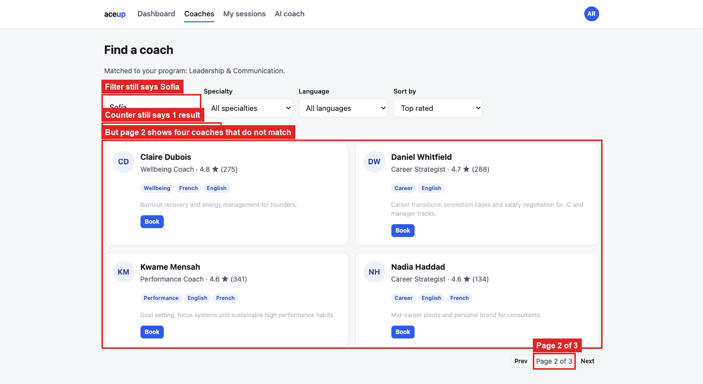

# BUG-03: page 2 throws away the search filter

> **Seed:** `2417` · Chrome 141, macOS 15 (Darwin 25.6.0) · viewport 1400x900 unless the
> finding says otherwise · app served over HTTP at `http://localhost:4173` · 28 Aug 2026
>
> Clear state before reproducing:
> ```js
> Object.keys(localStorage).filter(k => k.startsWith('aceup.')).forEach(k => localStorage.removeItem(k));
> ```
> Check the footer says **build 2417** before you start.

| | |
|---|---|
| **Severity** | High |
| **Priority** | P1 |
| **Where I think it lives** | Directory pagination. The page count comes from the unfiltered list, and the page-change handler re-renders from the full list too |

**Why High.** I opened this as a page-count bug and it turned out to be worse. Page 2 serves
coaches that contradict the filter still sitting in the search box. The user cannot tell
which screen to believe, and someone who lands on page 2 will reasonably conclude search is
broken.

**Preconditions:** clean state, seed 2417.

**Steps**
1. Open `http://localhost:4173/coaches.html?seed=2417`.
2. Search for `Sofía` (with the accent). One result: Sofía Ramírez.
3. Look at the pager. It says `Page 1 of 3` and **Next** is enabled.
4. Click **Next**.

**Expected**
One match means `Page 1 of 1` and a disabled **Next**. Pagination should run on the filtered
set.

**Actual**
The pager says `Page 1 of 3`. Clicking **Next** lands on `Page 2 of 3` showing **Claire
Dubois, Daniel Whitfield, Kwame Mensah and Nadia Haddad**, none of whom match `Sofía`, and
Sofía herself is gone. The search box still holds `Sofía` and the counter still says `1
coaches found`. The filter reaches the count but not the page.

## Screenshots



*`01_page-two-drops-filter.png`*
