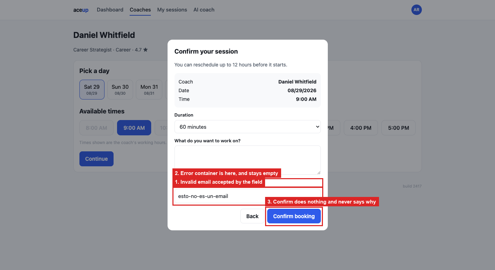

# BUG-05: an invalid guest email blocks the booking and says nothing

> **Seed:** `2417` · Chrome 141, macOS 15 (Darwin 25.6.0) · viewport 1400x900 unless the
> finding says otherwise · app served over HTTP at `http://localhost:4173` · 28 Aug 2026
>
> Clear state before reproducing:
> ```js
> Object.keys(localStorage).filter(k => k.startsWith('aceup.')).forEach(k => localStorage.removeItem(k));
> ```
> Check the footer says **build 2417** before you start.

| | |
|---|---|
| **Severity** | High |
| **Priority** | P1 |
| **Where I think it lives** | Guest-email validation in the confirmation modal. The error container renders but never gets filled |

**Why High.** Rejecting the address is correct. The problem is the silence. The button looks
dead, which from the user's side is the same as a broken app. They will click again, then
leave.

**Preconditions:** clean state, seed 2417.

**Steps**
1. Open `http://localhost:4173/booking.html?coach=c2&seed=2417` (Daniel Whitfield).
2. Keep **Sat 29**, click the **11:00 AM** slot, click **Continue**.
3. Type `esto-no-es-un-email` into **Invite a guest (optional)**.
4. Click **Confirm booking**.

**Expected**
Either the booking is rejected with a clear message next to the field, something like "Enter
a valid email address, or leave this blank", or the value is accepted. Rejecting without
telling anyone is not an option.

**Actual**
Nothing visible happens. The modal stays open, no message appears, no console error. The
booking is not created (`sessions` stays empty in `aceup.state.2417`) but `counters.book`
still ticks up to 1, so the attempt is half-processed.

Two things I found while digging. There is an empty `.hint` element inside the modal, 420 px
wide and 0 px tall, exactly where the message belongs. The container is there and never gets
text. And the field is `<input type="email">`, so the browser already knows the value is bad:
`checkValidity()` returns `false`. The native validation is available and simply is not being
surfaced.

Clearing the field, or entering `guest@company.com`, lets the same booking through straight
away. So the guest email is the only thing causing it.

## Screenshots



*`01_invalid-email-no-message.png`*
