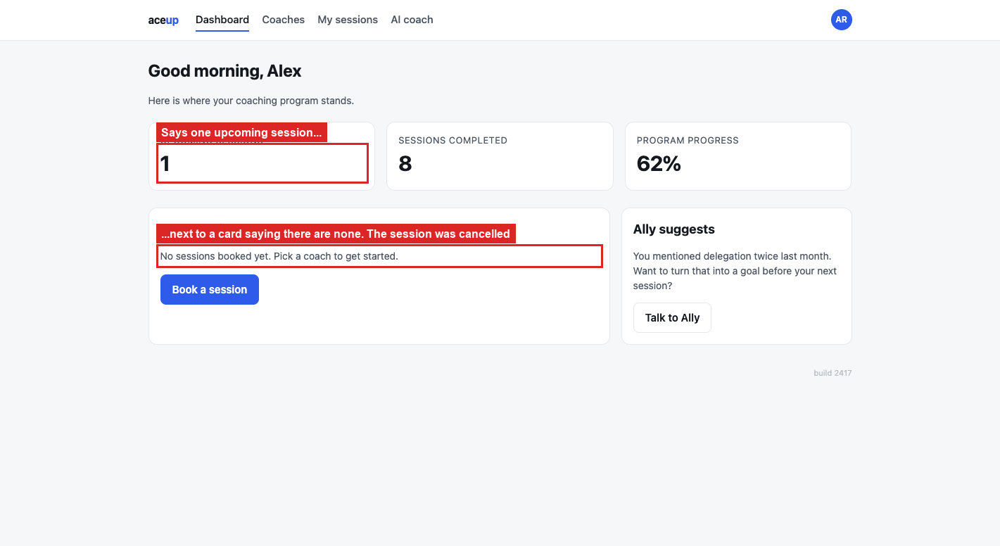
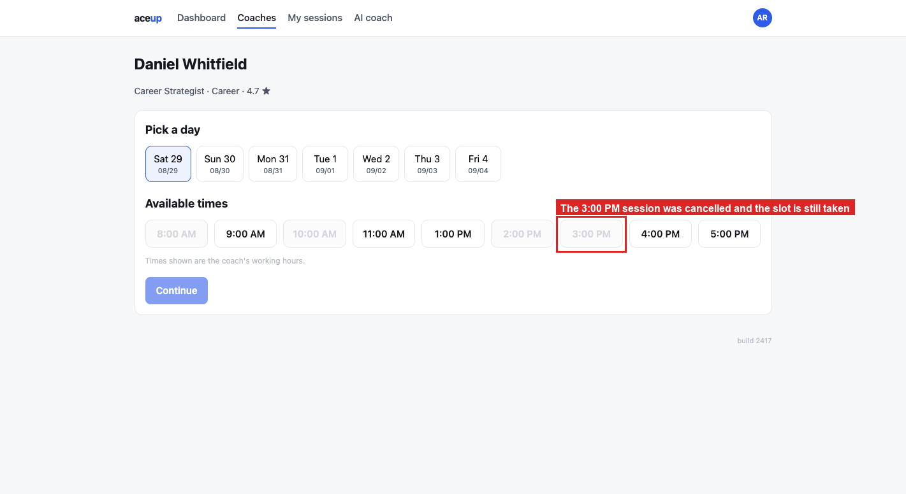

# BUG-06: cancelling leaves the dashboard count and the coach's slot stale

> **Seed:** `2417` · Chrome 141, macOS 15 (Darwin 25.6.0) · viewport 1400x900 unless the
> finding says otherwise · app served over HTTP at `http://localhost:4173` · 28 Aug 2026
>
> Clear state before reproducing:
> ```js
> Object.keys(localStorage).filter(k => k.startsWith('aceup.')).forEach(k => localStorage.removeItem(k));
> ```
> Check the footer says **build 2417** before you start.

| | |
|---|---|
| **Severity** | High |
| **Priority** | P1 |
| **Where I think it lives** | Cancel handler. `cachedUpcoming` is not recomputed and the `blocked[]` entry is not released |

**Why High.** Two visible problems from one cause, and the second is worse than it looks. A
cancelled slot stays unbookable, so the coach quietly loses availability that nobody can get
back through the UI. The dashboard contradicting itself also makes every other number on that
screen hard to trust.

**Preconditions:** clean state, seed 2417, one confirmed upcoming session.

**Steps**
1. Book a session, for example Daniel Whitfield, Sat 29, 3:00 PM.
2. Go to **My sessions**, click **Cancel**. The row flips to `CANCELLED` and the "Session
   cancelled" toast appears, both correct.
3. Go to **Dashboard**.
4. Go back to `booking.html?coach=c2&seed=2417` and look at the slot you just cancelled.

**Expected**
The dashboard shows `UPCOMING SESSIONS: 0`, matching the "no sessions booked" card next to
it. The cancelled slot is bookable again.

**Actual**
The dashboard shows `UPCOMING SESSIONS: 1` right beside a card that reads "No sessions booked
yet. Pick a coach to get started." The same screen contradicts itself.

In `aceup.state.2417`, `cachedUpcoming` is still `1` even though the only session is
`"status":"cancelled"`, and `blocked` still holds `"c2|2026-08-29|15"`, so that time cannot
be re-booked.

Worth knowing: reschedule handles `blocked[]` properly, releasing the old slot and taking the
new one. So this is an omission in the cancel handler, not a design limitation.

## Screenshots



*`01_counter-stays-at-one.png`*



*`02_slot-still-blocked.png`*
