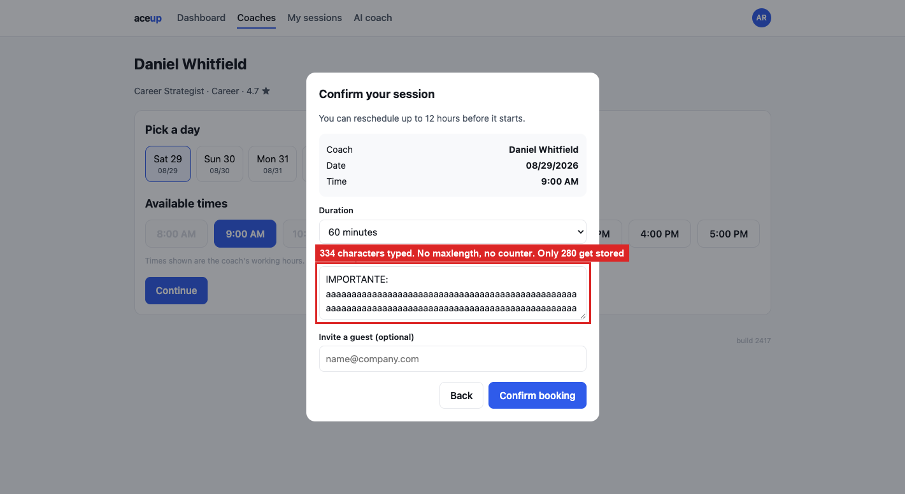

# BUG-07: session notes are cut at 280 characters without saying so

> **Seed:** `2417` · Chrome 141, macOS 15 (Darwin 25.6.0) · viewport 1400x900 unless the
> finding says otherwise · app served over HTTP at `http://localhost:4173` · 28 Aug 2026
>
> Clear state before reproducing:
> ```js
> Object.keys(localStorage).filter(k => k.startsWith('aceup.')).forEach(k => localStorage.removeItem(k));
> ```
> Check the footer says **build 2417** before you start.

| | |
|---|---|
| **Severity** | Medium |
| **Priority** | P2 |
| **Where I think it lives** | Booking submit handler. The note is trimmed before storage and the field declares no limit |

**Why Medium and not P1.** Losing data would normally rate higher, but the loss is bounded
and shows up once someone opens the session. What keeps it above cosmetic is that nobody is
told: no `maxlength`, no counter, and the trim happens after confirmation. The first person
to notice is the coach reading a note that stops mid-sentence.

**Preconditions:** clean state, seed 2417.

**Steps**
1. Open `http://localhost:4173/booking.html?coach=c8&seed=2417`.
2. Pick any free slot, click **Continue**.
3. In **What do you want to work on?** paste 333 characters ending in something you will
   recognise. I used `IMPORTANTE: ` + 300 × `a` + ` ESTE FINAL SE PIERDE`.
4. Click **Confirm booking**, then look at `aceup.state.2417`.

**Expected**
Either the whole note is stored, or the field shows its limit while you type.

**Actual**
Exactly 280 characters are stored. The other 53 are dropped, and `ESTE FINAL SE PIERDE` is
gone. The `<textarea>` has no `maxlength` and there is no counter anywhere in the modal, so
nothing warns you before, during or after. A 220-character note survives intact, which puts
the cut at 280.

The notes field is how a member tells their coach what the session is for. Someone who writes
a careful brief loses the end of it, and neither side can tell anything is missing.

## Screenshots



*`01_notes-no-limit-shown.png`*
