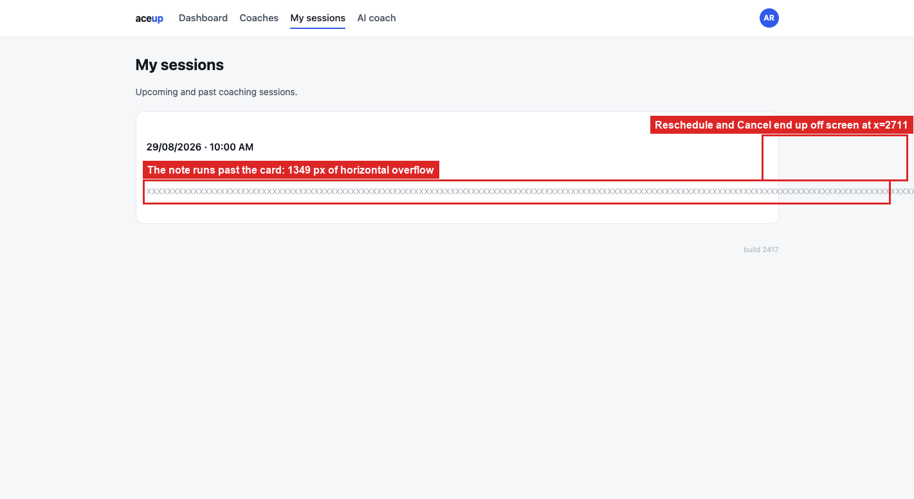

# BUG-08: one long word in the notes pushes Cancel off the screen

> **Seed:** `2417` · Chrome 141, macOS 15 (Darwin 25.6.0) · viewport 1400x900 unless the
> finding says otherwise · app served over HTTP at `http://localhost:4173` · 28 Aug 2026
>
> Clear state before reproducing:
> ```js
> Object.keys(localStorage).filter(k => k.startsWith('aceup.')).forEach(k => localStorage.removeItem(k));
> ```
> Check the footer says **build 2417** before you start.

| | |
|---|---|
| **Severity** | High |
| **Priority** | P1 |
| **Where I think it lives** | Session card CSS. The notes element uses `overflow-wrap: normal` and `word-break: normal` |

**Why High.** This is not just an ugly overflow. It puts **Reschedule** and **Cancel** out of
reach, so the member loses control of a booking they have already made. Ordinary pasted
content triggers it, and they cannot fix the note afterwards because the buttons that would
let them are the ones off screen.

**Preconditions:** clean state, seed 2417.

**Steps**
1. Book a session and put a string of more than about 60 characters with no spaces in the
   notes. A pasted token or ID does it. 280 × `X` reproduces it every time.
2. Go to **My sessions**.

**Expected**
The note wraps inside the card, the card keeps its width, and both buttons stay visible.

**Actual**
The note renders as one unwrapped line 2 280 px wide. The document grows to 2 759 px against
a 1 400 px viewport, so 1 359 px of horizontal overflow, and **Cancel** ends up at
`x = 2 701`, completely outside the visible area. You cannot cancel or reschedule that
session without finding the horizontal scrollbar first.

Computed style on the notes element is `overflow-wrap: normal; word-break: normal`.

One thing to know before writing a test for this: the notes column is about 485 px wide at
roughly 8 px per character, so anything past ~60 unbroken characters overflows. Normal prose
wraps fine, and strings with `-` or `_` break at those characters. You need a genuinely
unbroken run to reproduce it.

## Screenshots



*`01_long-note-breaks-layout.png`*
