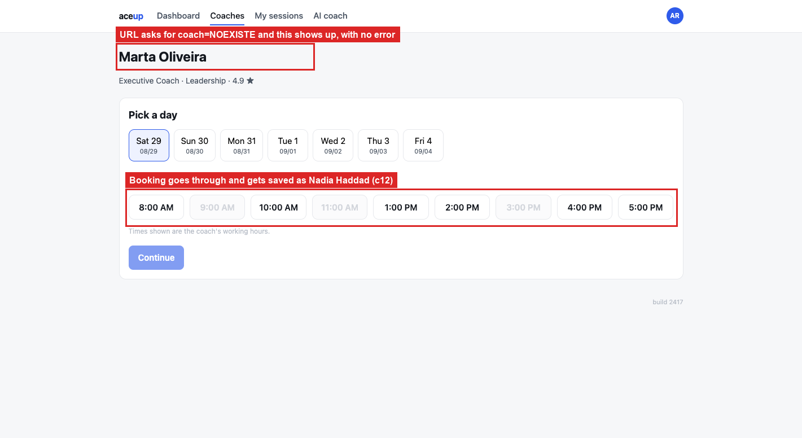

# BUG-09: an unknown coach id books someone else entirely

> **Seed:** `2417` · Chrome 141, macOS 15 (Darwin 25.6.0) · viewport 1400x900 unless the
> finding says otherwise · app served over HTTP at `http://localhost:4173` · 28 Aug 2026
>
> Clear state before reproducing:
> ```js
> Object.keys(localStorage).filter(k => k.startsWith('aceup.')).forEach(k => localStorage.removeItem(k));
> ```
> Check the footer says **build 2417** before you start.

| | |
|---|---|
| **Severity** | Critical |
| **Priority** | P0 |
| **Where I think it lives** | Booking page. The `coach` query parameter is not validated, and the header and the submit handler resolve it to two different coaches |

**Why P0.** This is the one that worries me most. You read one coach's name on screen,
confirm, and end up booked with somebody else. No error, no console warning, nothing on the
confirmation screen that would let you catch it. Stale bookmarks, mistyped links, or any
future change to coach ids all land here.

**Preconditions:** clean state, seed 2417.

**Steps**
1. Open `http://localhost:4173/booking.html?coach=NOEXISTE&seed=2417`.
2. Look at the page header.
3. Pick any free slot, click **Continue**, then **Confirm booking**.
4. Check `aceup.state.2417`, or open **My sessions**.

**Expected**
An unknown coach id is rejected. A "coach not found" message, or a redirect to the directory.
Booking should not proceed against a coach that could not be resolved.

**Actual**
The page renders normally and shows **Marta Oliveira** in the header and in the confirmation
modal. The booking goes through, and the stored session says `"coachId":"c12"`,
`"coachName":"Nadia Haddad"`. A third coach, matching neither the URL nor anything on screen.
Nothing in the console at any point.

With a valid id (`coach=c3`) the header, the modal and the stored record all agree on Ana
Beltrán, so this only happens on the unresolved-id path.

## Screenshots



*`01_unknown-coach-id.png`*
