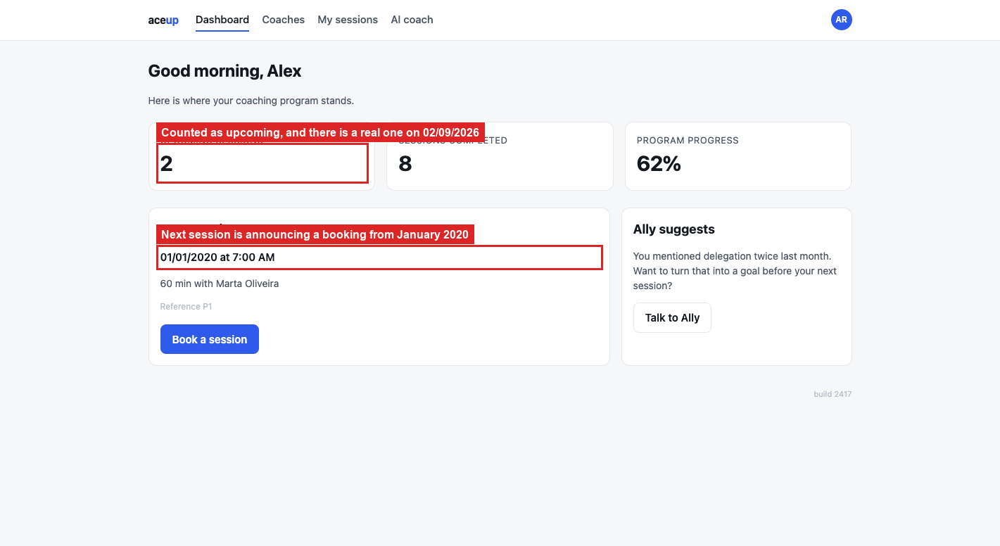

# BUG-11: past sessions are counted and announced as upcoming

> **Seed:** `2417` · Chrome 141, macOS 15 (Darwin 25.6.0) · viewport 1400x900 unless the
> finding says otherwise · app served over HTTP at `http://localhost:4173` · 28 Aug 2026
>
> Clear state before reproducing:
> ```js
> Object.keys(localStorage).filter(k => k.startsWith('aceup.')).forEach(k => localStorage.removeItem(k));
> ```
> Check the footer says **build 2417** before you start.

| | |
|---|---|
| **Severity** | High |
| **Priority** | P1 |
| **Where I think it lives** | Session classification. Nothing compares against the current date, on the dashboard or in the list |

**Why High.** The dashboard exists to answer "what's next", and it answers wrong as soon as
one past session exists. The app has no way to complete or archive a session, so every
booking eventually becomes a past one. That means this gets worse with use: the first session
a member ever booked keeps being announced as their next.

**Preconditions:** clean state, seed 2417, plus a session in the past. The booking UI only
offers the next 7 days, so seed the state directly:

```js
localStorage.setItem('aceup.state.2417', JSON.stringify({
  sessions: [
    {id:'P1', coachId:'c1', coachName:'Marta Oliveira', tzOffset:-3, tzLabel:'America/Sao_Paulo',
     date:'2020-01-01', hour:10, startsAt:'2020-01-01T10:00:00Z', duration:60,
     notes:'', guestEmail:'', status:'confirmed'},
    {id:'F1', coachId:'c2', coachName:'Daniel Whitfield', tzOffset:-5, tzLabel:'America/New_York',
     date:'2026-09-02', hour:14, startsAt:'2026-09-02T14:00:00Z', duration:60,
     notes:'', guestEmail:'', status:'confirmed'}
  ], blocked: [], counters: {book:2}, cachedUpcoming: 2
}));
```

**Steps**
1. Run that in the console, then open `http://localhost:4173/index.html?seed=2417`.
2. Read **UPCOMING SESSIONS** and the **Next session** card.
3. Open **My sessions**.

**Expected**
`UPCOMING SESSIONS` counts only future sessions, so 1. **Next session** shows 02/09/2026 with
Daniel Whitfield. The 2020 session shows as past, with **Reschedule** and **Cancel** removed.

**Actual**
`UPCOMING SESSIONS` reads 2, counting the 2020 session. **Next session** announces
01/01/2020, so the member never sees their real next appointment. In **My sessions** the 2020
session is still badged `CONFIRMED` and still offers **Reschedule** and **Cancel**, both
acting on something that already happened.

The screen is titled "Upcoming and past coaching sessions", so past sessions were clearly
meant to be handled. There is just no date comparison anywhere. Different cause from BUG-06,
and the two stack: a stale counter plus a wrong "next" makes the whole dashboard unreliable.

## Screenshots



*`01_past-session-shown-as-next.png`*
