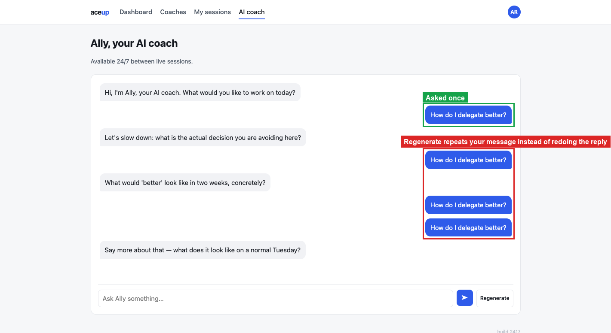
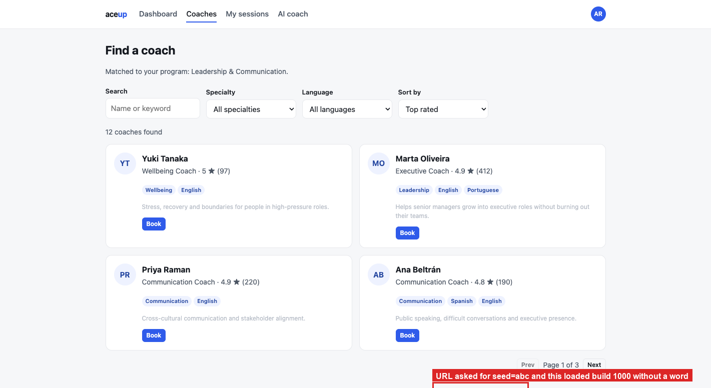

# Observations

Three things that reproduce but did not earn a place in `BUG_REPORT.md`. I would rather hand
over nine defects that matter than twelve where three are filler.

They are here because a reviewer should still know about them, and because two of the three
are a one-line fix once someone is already in that file.

| ID | What it is | Why it is not in the bug report |
|---|---|---|
| BUG-04 | The result counter reads "1 coaches found" | Cosmetic. One line, no user harm. |
| BUG-10 | Chat Regenerate repeats your message instead of replacing the reply | Makes the transcript untidy. Nobody loses a booking over it. |
| BUG-12 | A malformed seed in the URL silently loads build 1000 | Needs a hand-edited URL. Real users do not hit it. |

The regression tests for all three are still in `known-defects.cy.js` under their original
ids, so nothing is lost if the team decides one of them deserves a ticket after all.

> **Seed:** `2417` · Chrome 141, macOS 15 · clear state before reproducing:
> ```js
> Object.keys(localStorage).filter(k => k.startsWith('aceup.')).forEach(k => localStorage.removeItem(k));
> ```

---

## BUG-04: counter says "1 coaches found"

**Where I think it lives:** Result-count label

**Preconditions:** clean state, seed 2417.

**Steps**
1. Open `http://localhost:4173/coaches.html?seed=2417`.
2. Search for `Sofía` so exactly one coach matches.

**Expected:** `1 coach found`.
**Actual:** `1 coaches found`.

Cosmetic, but it sits on the main discovery screen and takes a line to fix. Filed separately
from BUG-03 because the cause and the fix are different.

## Screenshots


---

## BUG-10: Regenerate repeats your message instead of redoing the answer

**Where I think it lives:** Chat "Regenerate" handler, replaying the whole turn instead of swapping the last reply

**Preconditions:** clean state, seed 2417.

**Steps**
1. Open `http://localhost:4173/chat.html?seed=2417`.
2. Send `How do I delegate better?` and wait for Ally's reply.
3. Click **Regenerate** three times.

**Expected**
The last reply is replaced. Your message appears once.

**Actual**
Each click adds a fresh copy of your message plus a new reply. After three clicks `How do I
delegate better?` appears four times, including two copies in a row with no reply between
them. The transcript reads as if the member asked the same thing four times.

That transcript is the record of the coaching relationship. A member looking back at it
cannot tell what they actually asked, and it makes them look repetitive in something a human
coach may read.

## Screenshots



---

## BUG-12: a bad seed quietly switches you to build 1000

**Where I think it lives:** `seed.js`. The `?seed=` parameter is not validated, and the fallback is persisted as if the user had chosen it

**Preconditions:** clean state.

**Steps**
1. Open `http://localhost:4173/coaches.html?seed=abc`.
2. Read the build number in the footer.
3. Click **Dashboard** and look at the address bar.

**Expected**
Either reject the invalid seed with a visible message, or fall back to a default and say so.
Either way, do not silently persist the fallback as the user's seed.

**Actual**
The footer reads **build 1000**. `localStorage['aceup.seed']` is overwritten from `2417` to
`1000`, and every nav link is rewritten to `?seed=1000`, so clicking **Dashboard** lands on
`index.html?seed=1000`. No message, no console warning. You carry on browsing a different
build than the one you asked for.

## Screenshots


