# UX and accessibility findings

**Seed:** `2417` · Chrome 141, macOS 15 · tested at 1400x900 and at 320 and 375 px wide
· 28-29 Aug 2026

Eleven findings, grouped into the four themes they actually fall into. Kept separate from the
functional bugs in [`BUG_REPORT.md`](../../../BUG_REPORT.md).

Two of these are more serious than anything in the bug report, and they are both in the first
group.

| Theme | Findings | Worst of them |
|---|---|---|
| [Accessibility](#accessibility) | UX-01, UX-02 | Booking is impossible with a keyboard |
| [Feedback](#feedback-and-error-states) | UX-03, UX-08, UX-09, UX-10 | Blank screen means loading, empty, or broken |
| [Clarity](#clarity-of-what-is-on-screen) | UX-05, UX-06, UX-07 | The same session shows two different dates |
| [Responsive and platform](#responsive-and-platform) | UX-04, UX-11 | 103 px of horizontal scroll at 320 px |

---

# Accessibility

The one group I would treat as release-blocking. Both findings here break the primary task
outright for keyboard and screen-reader users, and both fail WCAG at Level A.

## UX-01: you cannot pick a time with a keyboard

**What I saw.** On `booking.html` the nine time slots are `
`. No `role`, no `tabindex`, no `aria-label`. Tabbing through
the page goes from the day buttons straight to Continue. None of the 18 focusable elements on
that page is a time slot. There is no `aria-selected` either, so the current choice is never
announced.

**What it costs.** This blocks the whole product. Someone using a keyboard or a screen reader
cannot pick a time, so they cannot book a session at all. Unavailable slots are conveyed only
through colour and a `taken` class, so assistive tech cannot see those either. That is a WCAG
2.1 failure on 2.1.1 Keyboard, Level A. For a corporate coaching product, accessibility
conformance tends to show up in procurement, so there is a commercial cost on top of the
obvious one.

**What I would do.** Make the slots real `<button type="button">` elements. If that breaks the
styling, `role="option"` with `tabindex="0"` inside a `role="listbox"` works too. Use
`aria-selected` for the current pick and `disabled` / `aria-disabled` for taken slots, and add
a text or icon cue next to the colour.

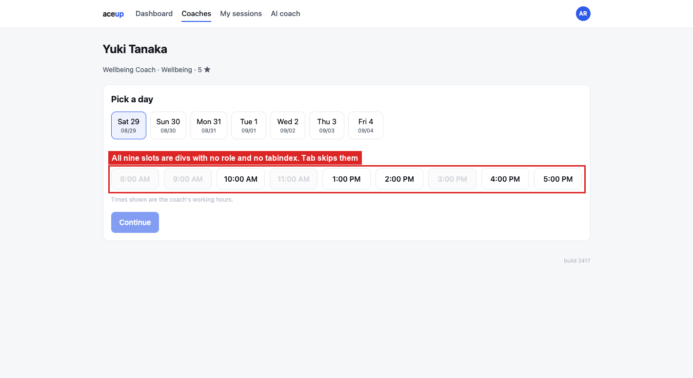

## UX-02: the confirmation modal is not really a modal

**What I saw.** It is a `
`. No `role="dialog"`, no
`aria-modal="true"`. With it open, the day buttons and Continue behind it are still focusable,
so Tab walks straight out of the dialog and behind the overlay. Escape does nothing.

**What it costs.** Keyboard and screen-reader users lose their place. Focus lands on controls
that are visually covered, and activating one changes the selection behind the dialog they are
still inside. Escape is the one thing everybody knows about modals, so when it does not work
people hunt for Back. Screen readers never announce this as a dialog, so its boundaries are
invisible.

**What I would do.** Use the native `<dialog>` element with `showModal()` and most of this
comes for free. Otherwise: `role="dialog"`, `aria-modal="true"`, `aria-labelledby` on the
title, trap focus inside, move focus in on open and back to the trigger on close, and bind
Escape.

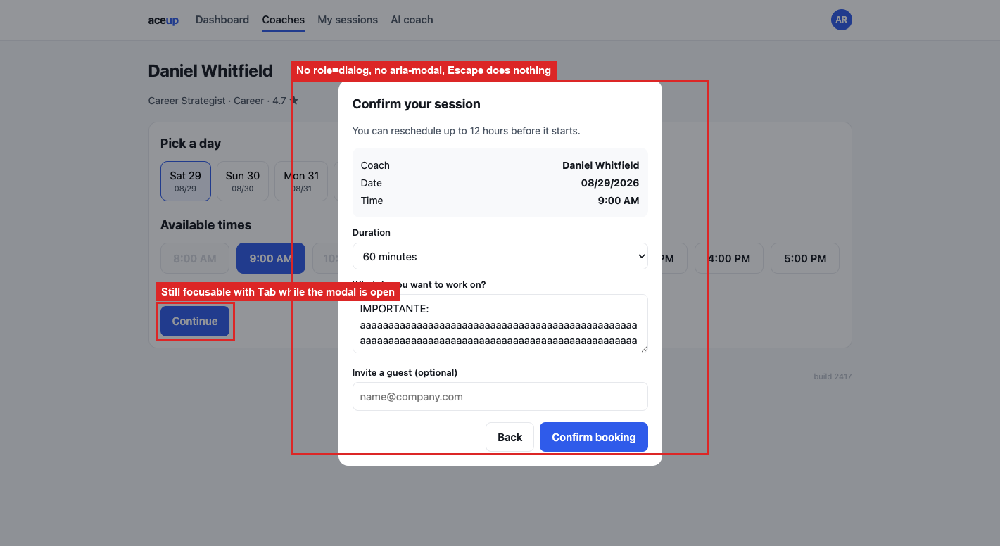

---

# Feedback and error states

A theme rather than four separate problems: the app rarely tells you what just happened. A
blank region can mean loading, no results, or a failure, and there is no way to tell which.

## UX-03: a search with no results shows nothing at all

**What I saw.** Search for something that does not match and the counter reads `0 coaches
found` with a completely blank area below it. No message, no suggestion, no way forward.

**What it costs.** A blank region reads as a failure, not as an answer. With 200 to 900 ms of
artificial latency in this build, you cannot tell "nothing matched" from "still loading" or
"it crashed". Most people will reload or leave.

**What I would do.** Say it out loud: "No coaches match *Sofia*", with a Clear filters button,
and echo the active query and filters so people can see what to relax.

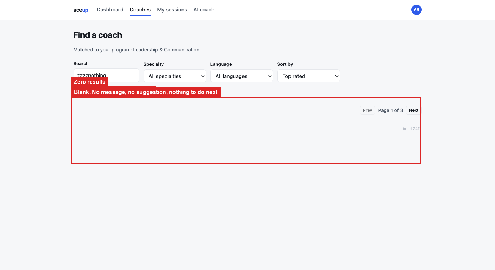

## UX-10: 724 ms of blank screen with no loading indicator

**What I saw.** Loading `coaches.html` leaves the results area empty for 724 ms. I measured it
by sampling every 60 ms from page start until the first card appeared. No spinner, no
skeleton, no "Loading…", no result count. The page chrome and the filters render straight away
and the content region just sits there empty.

**What it costs.** That blank window looks exactly like UX-03 above. Someone who searches and
glances up during that first second sees what they would see if nothing matched, and may start
changing filters or reload while the original request is still in flight. The artificial
latency is a documented constraint of this build, but the missing feedback is not, and real
networks are slower than this rather than faster.

**What I would do.** Show a skeleton list or spinner the moment the request starts, and keep
the previous results visible but dimmed while a filter re-query runs. Combine that with a
proper empty state so loading and nothing-found can never look the same.

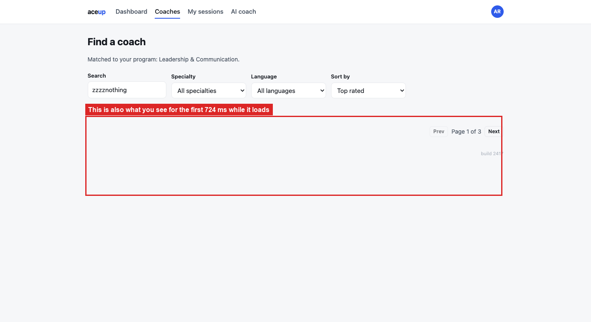

## UX-09: broken links fail quietly

**What I saw.** `booking.html?coach=NOEXISTE` renders a perfectly normal booking page for some
arbitrary coach. No error, no warning, nothing in the console. That is BUG-09 in the bug
report.

**What it costs.** A stale bookmark or a mistyped link drops you into a flow that looks
completely healthy. Silent fallback is worse than an error page here, because there is no
signal to stop, and you finish a booking you never meant to make.

**What I would do.** Validate the `coach` parameter on load, show a "We could not find that
coach" state with a link back to the directory, and never fall back to an arbitrary record.

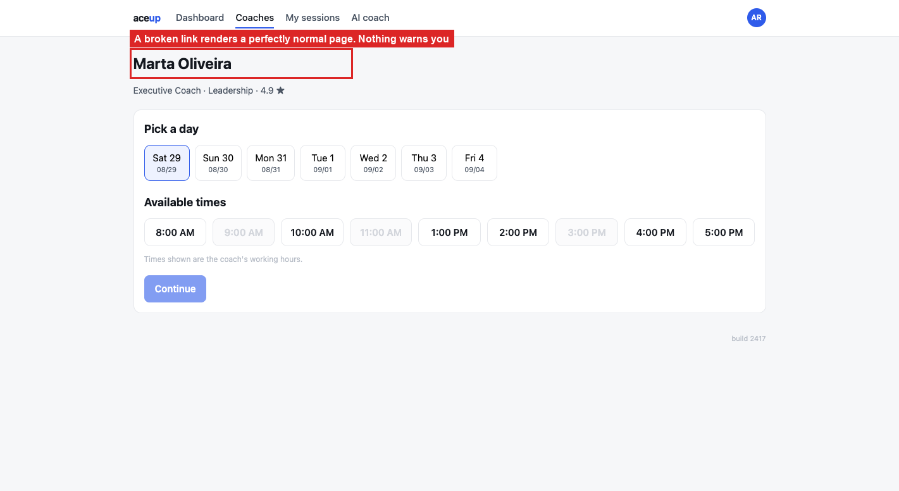

## UX-08: fields do not tell you their limits until you have already hit them

**What I saw.** Neither the session-notes `<textarea>` nor the chat input has a `maxlength` or
a character counter. The notes field still caps stored content at 280 characters (BUG-07), and
any unbroken run over about 60 characters breaks the session card (BUG-08).

**What it costs.** You type freely, see all of it on screen, confirm, and only later find out
some of it was dropped. A limit the interface never mentions is a limit nobody can respect.
The gap between what the field accepts, which is unlimited, and what the system stores, which
is 280, is exactly where the data goes missing.

**What I would do.** Add `maxlength` matching the storage limit, show a counter once you pass
about 80% of it, and set `overflow-wrap: anywhere` on anything that renders user text. Ideally
the limit is defined once and shared by the field and the storage layer so the two cannot
drift apart.

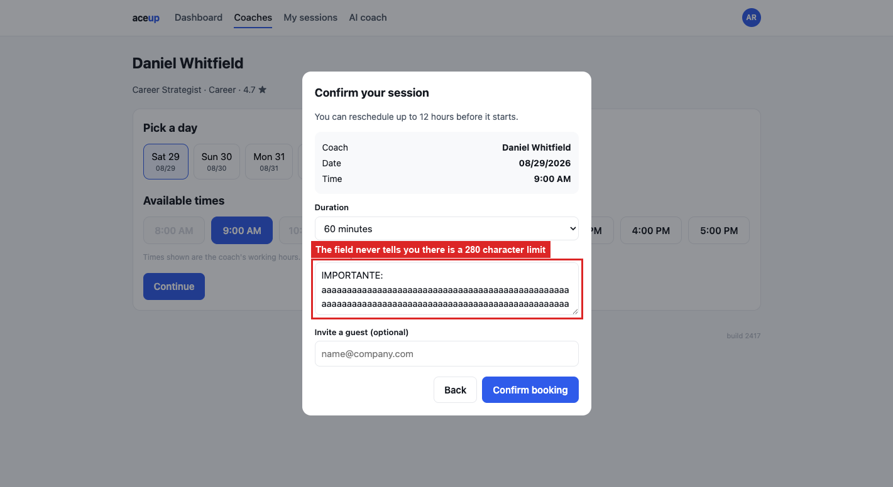

---

# Clarity of what is on screen

These three are about the app stating things ambiguously or wrongly. None of them break a
flow; together they make the numbers on screen harder to trust.

## UX-05: two screens, two date formats, same session

**What I saw.** The same session renders as `02/09/2026 · 11:00 AM` on My sessions and
`09/02/2026 at 11:00 AM` on the Dashboard. Day first in one place, month first in the other,
and different separators.

**What it costs.** That date is genuinely ambiguous. `02/09` is 2 September to a European
reader and `09/02` is 9 February to an American one, and the app shows both strings for the
same booking. There is no way to tell which screen is right. A scheduling product that cannot
state a date clearly makes every other number it shows harder to trust, and it stacks with
BUG-01: someone checking a time that looks wrong now has two date formats to reconcile too.

**What I would do.** Pick one format, put it in a single helper, and use something unambiguous
like `29 Aug 2026, 5:00 PM`. Derive it from the user's locale rather than hard-coding it per
screen.

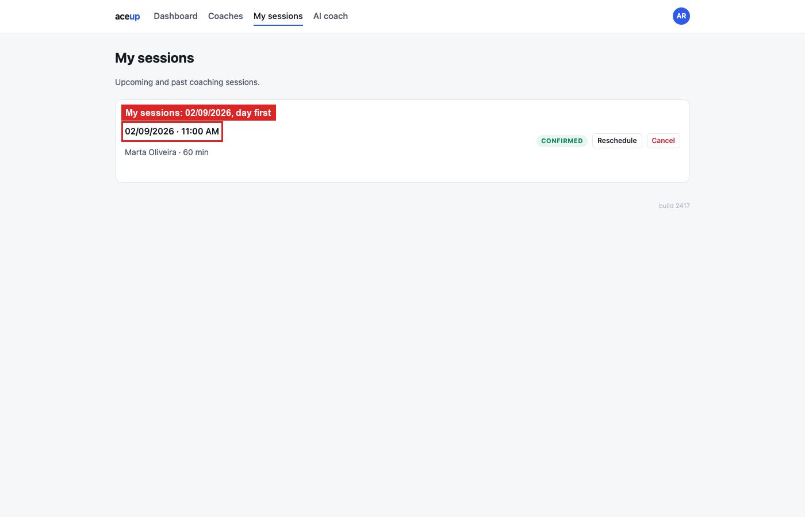

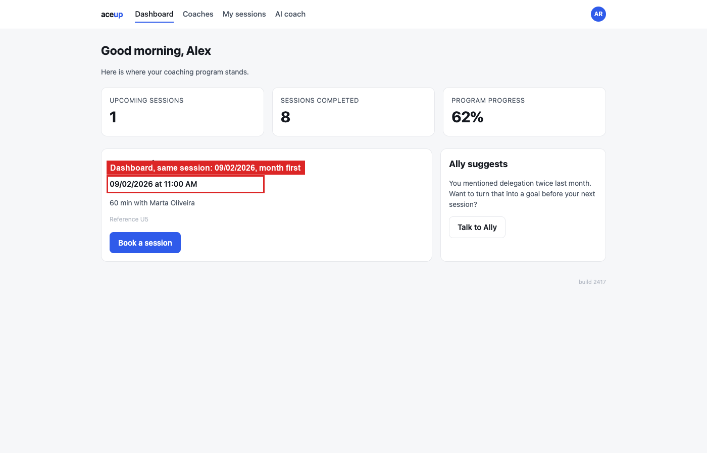

## UX-06: times are shown without ever saying which timezone

**What I saw.** The booking screen says "Times shown are the coach's working hours." No
timezone appears anywhere, even though every session record carries a `tzLabel` like
`America/Sao_Paulo` or `Asia/Tokyo`, and the coaches are spread across them.

**What it costs.** You cannot tell whether "5:00 PM" is your time or the coach's. That
ambiguity is exactly what makes BUG-01 so damaging: with no timezone on screen, a shifted time
looks plausible instead of obviously wrong, so nobody catches it before the session is missed.

**What I would do.** Put the timezone next to the time, either "5:00 PM (your time)" or
"5:00 PM BRT", and state on the confirmation screen which zone the booking is recorded in.
Worth doing regardless of how BUG-01 gets fixed.

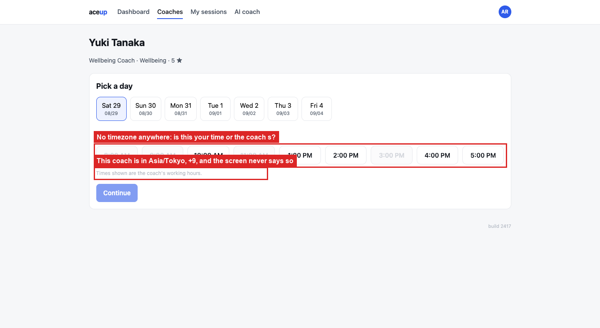

## UX-07: "1 coaches found"

**What I saw.** With one match, the directory says `1 coaches found`.

**What it costs.** Small, but it is on the main discovery screen and reads as unfinished.

**What I would do.** Pluralise from the count. Also in `OBSERVATIONS.md` as BUG-04, since it
is a deterministic text defect with a concrete expected value.

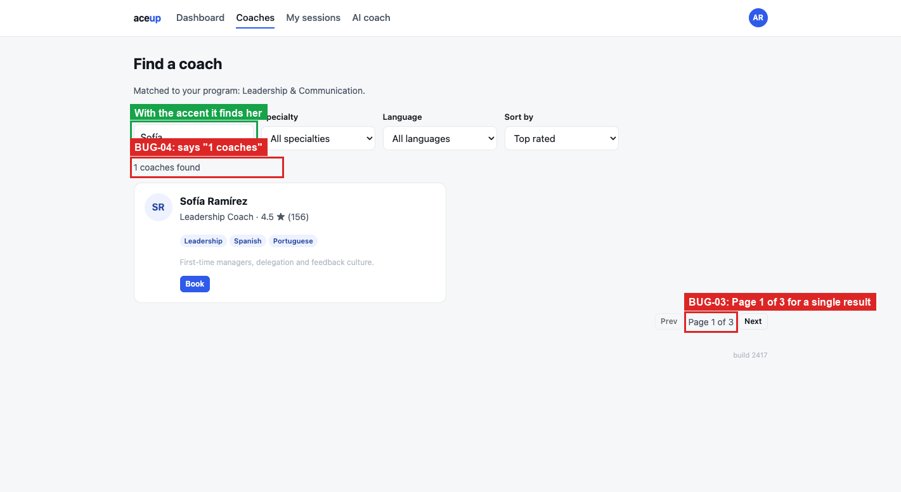

---

# Responsive and platform

## UX-04: horizontal scrolling at 320 px

**What I saw.** At 320 px wide, `coaches.html` has a document width of 423 px against a client
width of 320, so 103 px of horizontal overflow. "My sessions" and "AI coach" in the nav get
pushed off screen along with the avatar, and the coach cards keep a two-column grid so the
second card is cut in half. At 375 px it is smaller but still there.

**What it costs.** 320 px covers small Android phones and anyone using display zoom. You have
to scroll sideways to read a coach's name and rating, and nav items are unreachable unless you
discover the horizontal scroll. People book coaching between meetings, on a phone.

**What I would do.** Drop the card grid to one column below about 480 px, let the nav wrap or
collapse into a menu button, and add a check that
`document.documentElement.scrollWidth <= clientWidth` at 320 px so this cannot come back.

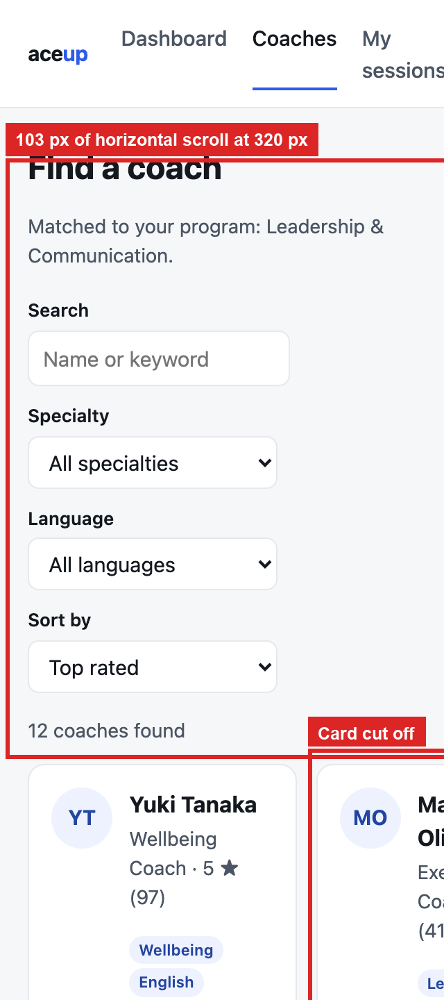

## UX-11: one tab does not know what the other did

**What I saw.** With the app open in two tabs, cancelling a session in tab A leaves tab B
showing it as `CONFIRMED` with the old count. There is no `storage` event listener, so tab B
only catches up on a manual reload.

**What it costs.** Not common, but confusing when it happens: you act on stale data in the
second tab and see actions apply to a session that is not in the state you think it is.

**What I would do.** Listen for the `storage` event and re-render. With no backend that is the
only cross-tab mechanism available, and it is a few lines.

I put this here rather than in the bug report because `app/README.md` only promises that
booked sessions survive page loads and says nothing about cross-tab sync. Worth checking the
intended behaviour with product rather than assuming either way.

*(No screenshot: this one needs two windows side by side to show anything.)*

---

## What I did not cover

- No screen-reader pass with VoiceOver or NVDA. The accessibility findings above come from the
  accessibility tree and the DOM, so they understate what a real AT session would surface:
  announcement order, and whether the toasts are announced at all.
- No colour-contrast measurement against WCAG 1.4.3, and nothing tested at 200% browser zoom.
- No `prefers-reduced-motion` check on the modal and toast transitions.
